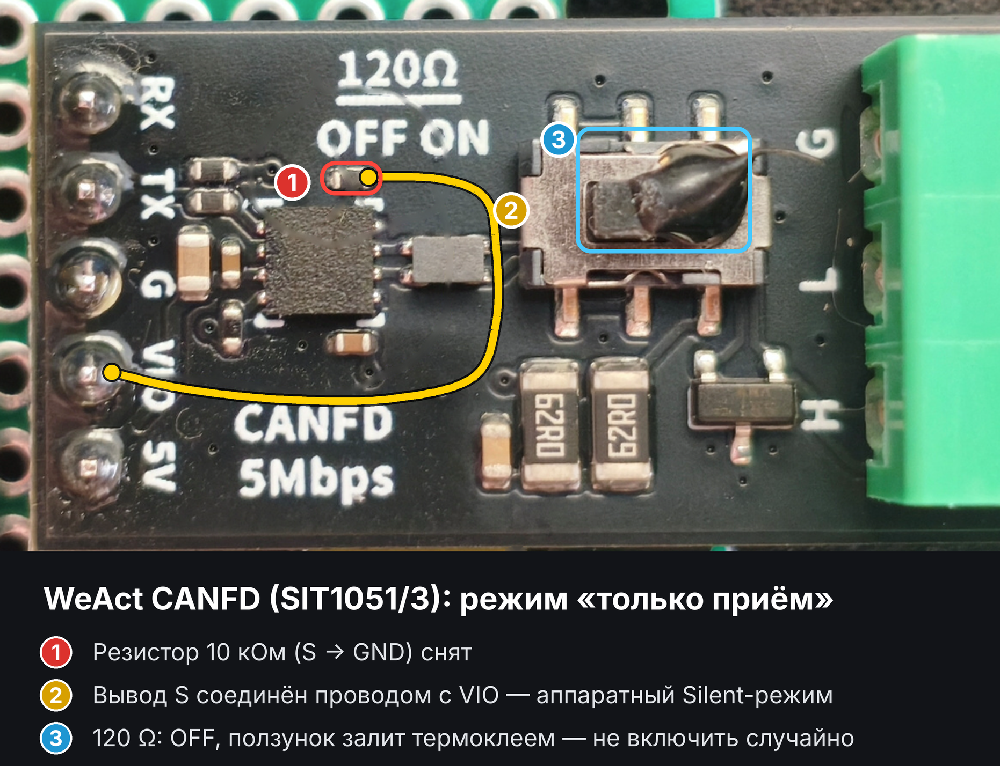
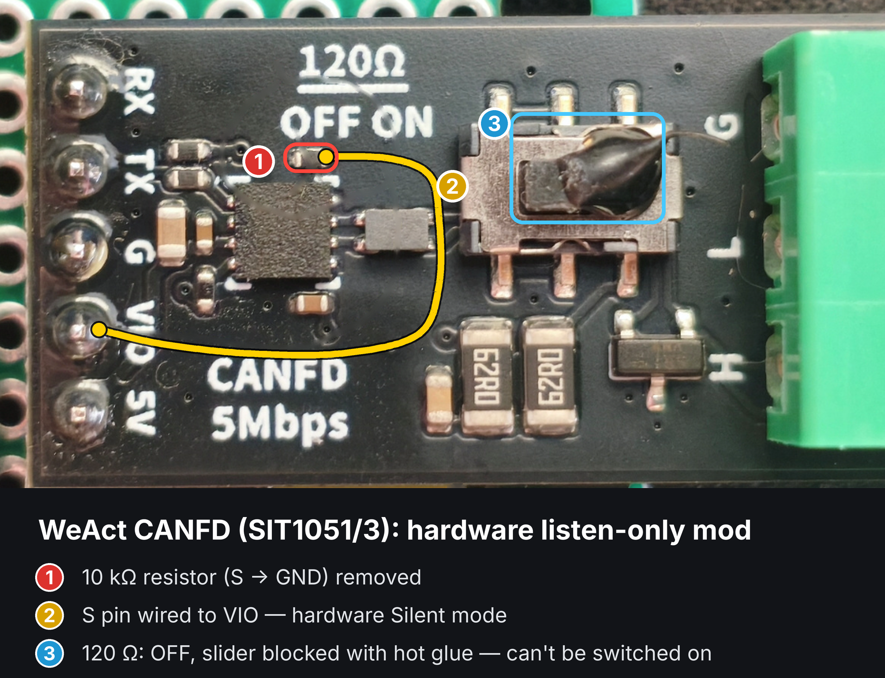

# Доработка WeAct CANFD (SIT1051/3): аппаратный режим «только приём»

Модуль WeAct CANFD штатно выпускается с резистором 10 кОм, подтягивающим вход **S** трансивера к земле — трансивер всегда в обычном режиме и **может передавать** в шину. Для снифера и HUD, которые только слушают CAN автомобиля, это лишний риск: сбой прошивки или плохой контакт не должен влиять на шину (на CAN-Infotainment сидит в том числе селектор АКПП).

Доработка делает режим **Silent** аппаратным — передатчик отключён независимо от прошивки.

## Что сделано

1. **Снят резистор 10 кОм** между выводом S и GND (на фото — красная рамка).
2. **Вывод S соединён тонким проводом с VIO** (жёлтая линия): на S постоянно логическая «1» → Silent-режим. Провод идёт от контакта VIO на гребёнке к площадке S.
3. **Переключатель терминатора 120 Ω переведён в OFF и залит каплей клея из термопистолета** — включить 120 Ом случайно уже нельзя. Шина автомобиля уже согласована, лишние 120 Ом искажают сигнал и нагружают шину.

## Проверка

- Мультиметр: S ↔ VIO — 0 Ом, S ↔ GND — разрыв.
- CANH ↔ CANL на выключенном модуле — не ~60 Ом, а десятки кОм (терминатор отключён).
- В шину ничего не передаётся; приём работает штатно (в прошивке используется `LISTEN_ONLY`).

> Все действия — на свой риск. Паять тонкий провод к площадке S удобнее под лупой, жалом до 300 °C.

---

# WeAct CANFD (SIT1051/3) mod: hardware listen-only

The WeAct CANFD module ships with a 10 kΩ resistor pulling the transceiver's **S** pin to GND, i.e. always in normal mode and **able to transmit**. For a sniffer or a HUD that only listens to the car's CAN bus this is an unnecessary risk: a firmware crash or a bad contact must not be able to affect the bus (the gear selector sits on CAN-Infotainment, among other things).

This mod makes **Silent** mode a hardware property — the driver is off regardless of firmware.

## What was done

1. **The 10 kΩ resistor between S and GND removed** (red frame in the photo).
2. **S pin wired to VIO** with a thin wire (yellow line), from the VIO header pad to the S pad: S is permanently high → Silent mode.
3. **The 120 Ω termination switch set to OFF and blocked with a drop of hot-melt glue**, so the terminator can't be enabled by accident. The car's bus is already terminated; extra 120 Ω degrades the signal.

## Checks

- Multimeter: S ↔ VIO = 0 Ω, S ↔ GND = open.
- CANH ↔ CANL on the unpowered module is tens of kΩ, not ~60 Ω (terminator off).
- Nothing is transmitted to the bus; reception works normally (firmware uses `LISTEN_ONLY`).

> Do this at your own risk. Use a magnifier and an iron at ≤300 °C for the fine wire.
