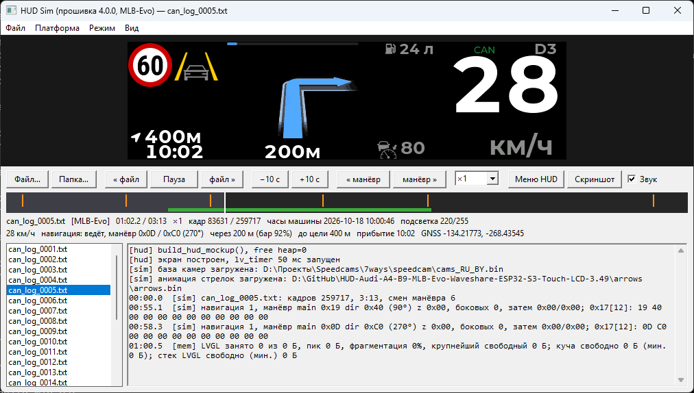

# HUD Sim — the HUD screen on a PC (Windows), driven by sniffer logs

**Simulator version 1.0.0** · [Русская версия](README_ru.md)

The program shows the 640×172 HUD screen on a computer and plays recorded sniffer logs (`can_log_NNNN.txt`) into it.
The screen is drawn by **the same code as in the firmware**: `hud_mockup.c`, `can_decode.c` (for MLB-Evo and for MQB),
`psd_speedlimit.c`, `cam_alert.c`, `hud_settings.cpp`; the fonts and images are taken from `waveshare_hud_mockup/`
without a single edit and built together with LVGL 8.4. Changed something in the screen or the decoder? Rebuild
`hud_sim.exe` and look at the result on a real drive without flashing the board.


*The simulator window: the HUD screen (full mode with an animated arrow), the timeline with manoeuvre marks, the list of trip logs and the firmware log*

> **Logs have to be recorded beforehand.** The simulator captures nothing from the car, it only plays back `can_log_NNNN.txt` files.
> They are written by the ESP32 CAN logger: [esp32-CAN-sniffer-logger-screener](https://github.com/WARMW00D/esp32-CAN-sniffer-logger-screener).
> Drive the route you need with it (for the map and navigation, with route guidance switched on), then open the file or folder
> with the recording in the simulator.

## Running

`hud_sim.exe` is built with `build_win.bat` (see "Building"); there is no ready exe in the repository, and nothing has to be
installed. Open a log file or a trip folder with the buttons, the "File" menu, by dropping it onto the window or as a command-line argument:

```
hud_sim.exe D:\logs\trip
```

The files of a folder are listed on the left and played one after another. If the timestamps of the next file continue
the previous one (the same trip), the HUD moves on to it without a break.

## Platform: MLB-Evo / MQB

The "Platform" menu switches the CAN signal map of the decoder, the same as `HUD_PLATFORM` in `hud_config.h`
(`HUD_PLATFORM_MLB_EVO` / `HUD_PLATFORM_MQB`). In the firmware this is a build-time choice, so `can_decode.c` is built into the program
twice and the instances are switched on the fly: the current place of the log is replayed at once through the selected decoder.
The choice is kept in `hud_sim.ini` and shown in the window title and the status line. Open MQB logs with the MQB
platform and A4 logs with MLB-Evo: the platform cannot be detected from the log itself.

## Screen mode: full / minimalist

The "Mode" menu (or the `D` key) switches the screen between the full and the minimalist layout, the same as the "Mode" button in the
HUD settings menu (`HUD_DISPLAY_MODE` in `hud_config.h`, `hud_set_mode()` in the firmware). Switching is instant and the choice
is kept in `hud_sim.ini`; the same button works with the mouse in the HUD menu (`M`), and the tick in the "Mode" menu follows it.
The minimalist screen is built from the same firmware files (`hud_mockup.c`, `hud_min_images.c`, the `hud_font_m*.c` fonts), no
separate build is needed.

## Controls

| Action | Button | Key |
|---|---|---|
| Play / pause | "Play" | Space |
| Back / forward 10 s (60 s) | "−10 s", "+10 s" | ← / → (with Shift) |
| Next / previous navigation manoeuvre | "manoeuvre »", "« manoeuvre" | N / P |
| Speed ×0.25 … ×32 | list | ↑ / ↓ |
| Next / previous file | "file »", "« file" | PgDn / PgUp |
| HUD settings menu | "HUD menu" or a double click on the screen | M |
| Screen mode: full / minimalist | "Mode" menu | D |
| Map (OpenStreetMap / Yandex / 2GIS) | "Map" | K |
| Screenshot (PNG into `shots\` and to the clipboard) | "Screenshot" | S |

- **Timeline**: click or drag to seek. The green bar is navigation guiding along a route (BAP `RG_Status` = 1), the orange marks
  are manoeuvre changes (BAP `ManeuverDescriptor`).
- **Mouse on the HUD screen** is the touch: the menu buttons are pressed as on the board. The menu opens at any speed (in the car only
  when stopped): for this the screen is built through `sim_mockup.c` with `HUD_MENU_ONLY_STOPPED 0`; `hud_mockup.c` itself is unchanged.
- **Status lines**: position in the file, the car clock from the log, the backlight the HUD would set, the speed, the navigation
  state (manoeuvre, distance, bar graph, remaining distance, time), GNSS.
- **Log** (bottom right): what the firmware writes to Serial (`[hud]`, `[cam]`, `[nav]`, `[LVGL]` — by the `HUD_LOG_*` flags in
  `hud_config.h`), and a line for every manoeuvre change with the raw BAP `0x17` message — handy for working out new arrow codes.

The settings of the HUD menu and of the program itself are kept in `hud_sim.ini` next to the exe (instead of NVS): the firmware's
`hud_settings.cpp` is built as is, so new menu items are saved by themselves.

## Interface language

The "Язык / Language" menu switches between Russian and English. Buttons, menus, status lines, the log and the map window are
translated; the choice is stored in `hud_sim.ini` (`[sim] lang=ru|en`). Until you choose, the Windows UI language is used.
The HUD screen itself does not change with it: that is set by the firmware settings (HUD menu).

## Map (OpenStreetMap / Yandex / 2GIS)

The "Map" button (key K, "View" menu) opens a separate window (Edge or Chrome in app mode, otherwise the default browser)
with the car position from the log's GNSS data (CAN `0x486` NavPos_01, heading from `0x484`). The marker moves with playback
and seeking. For this `hud_sim.exe` starts a local server on `127.0.0.1:8765` (port: `[map] port` in `hud_sim.ini`; if busy,
the next one is used) and serves `map.html`, which sits next to the exe and can be edited without rebuilding.

* **OpenStreetMap** is the default and needs no key (max zoom 19, no lanes): good for checking that the coordinates move.
* **Yandex** and **2GIS** need their own free API key: Yandex — JavaScript API in the developer console, 2GIS — MapGL at
  platform.2gis.ru. Paste the key into the field at the bottom of the map window (remembered in the browser) or put it into
  `hud_sim.ini`: `[map] yandex_key=…`, `gis_key=…`.
* Zoom: the −/+ buttons or keys, up to 21. "Lanes" switches to satellite at maximum zoom. "Follow" keeps the car centred,
  "track" draws the path travelled. With no GNSS fix the marker stays at the last known position.

## Animated arrows (full mode)

`arrows.bin` (made by `tools/gen_arrow_anim.py`; a ready one is in `arrows/` of the repository) is picked up automatically: from `hud_sim.ini`,
next to the exe, or from `..\..\arrows\arrows.bin` — so when the simulator sits in `tools\hud_sim_win` of the repository nothing has to be done.
Otherwise use the "File" → "Load arrow animation" menu or drop the file onto the window. As on the board, the "Arrow animation" button
appears in the HUD menu only with this file (second row, next to "Fuel"), and the full mode plays the animation; the minimalist mode
does not animate the arrows. Without the file the log shows `[sim] arrows.bin not found`.

## Cameras

`cams.bin` — put it next to the exe, drop it onto the window or choose it in the "File" menu. Without the database cameras are
simply not shown.

## What is different from the board

- The frame source is a file: **all** frames of the log go into the decoder, as with an own transceiver (TWAI). The BLE path
  (`ble_can_client.cpp`, the ACL filter, packing) is not involved.
- The HUD time is the log time: on pause it stands still (so do the freshness timeouts), at ×8 it runs eight times faster. On a seek the
  time jumps forward by 2 minutes (everything old expires by timeout), then the 30 s before the chosen point are played instantly — so
  navigation and signs appear at once after a seek.
- The sound goes through the PC sound card; the start-up sound is not played.
- There is no photoresistor (the calibration panel shows a constant 1200 mV) and no update (OTA) mode.
- LVGL memory is a plain `malloc`, not the 96 KB PSRAM pool from the board's `config/lv_conf.h`: the simulator will not show an LVGL
  out-of-memory (on the board the `[mem]` log line does, `HUD_LOG_MEM`; it is switched off in the simulator).
- `.lzma` logs have to be unpacked first.

## Building

`build_win.bat` needs `git` and a compiler in `PATH`: [zig](https://ziglang.org/download/) (one archive, no installation) or MinGW-w64
`gcc`/`g++`. On the first run the script downloads LVGL 8.4.0 into `lvgl\` and builds it (a few minutes); after that only the HUD files are rebuilt.

The firmware folder is looked up in `..\..\waveshare_hud_mockup`, i.e. when `hud_sim_win` sits in `tools\` of the repository nothing has to be
specified. If the simulator folder is elsewhere, pass the path once, it is remembered in `fw_path.txt`:

```
build_win.bat D:\GitHub\HUD-Audi-A4-B9-MLB-Evo-Waveshare-ESP32-S3-Touch-LCD-3.49\waveshare_hud_mockup
```

All `.c` files of the firmware folder are built except the hardware-bound ones (`hud_sound.c`, `i2c_bsp.c`, `lvgl_port.c`), so new font and
image files are picked up by themselves.

| File | What is in it |
|---|---|
| `sim_core.c/.h` | time, screen, touch, hardware stubs (sound, backlight, OTA, source), the log player |
| `sim_decode_mlb.c`, `sim_decode_mqb.c` | the firmware's `can_decode.c` built for each platform |
| `sim_mockup.c` | the firmware's `hud_mockup.c` with the menu available at any speed and the `[mem]` log off |
| `sim_win.c` | the Windows window (Russian and English UI) |
| `sim_map.c/.h`, `map.html` | the local server and the page of the map window |
| `sim_headless.c` | the same core without a window: one HUD frame from a log into a BMP (`build_headless.sh`, Linux/WSL; `mode=1` — minimalist screen, `SIM_ARROWS=<path>` — animated arrows) |
| `lv_conf.h` | LVGL settings: 16 bit, compressed fonts — as in the firmware |
| `shim/` | stub headers of ESP-IDF / FreeRTOS / Arduino (`Preferences` → `hud_sim.ini`) that the firmware files include |
